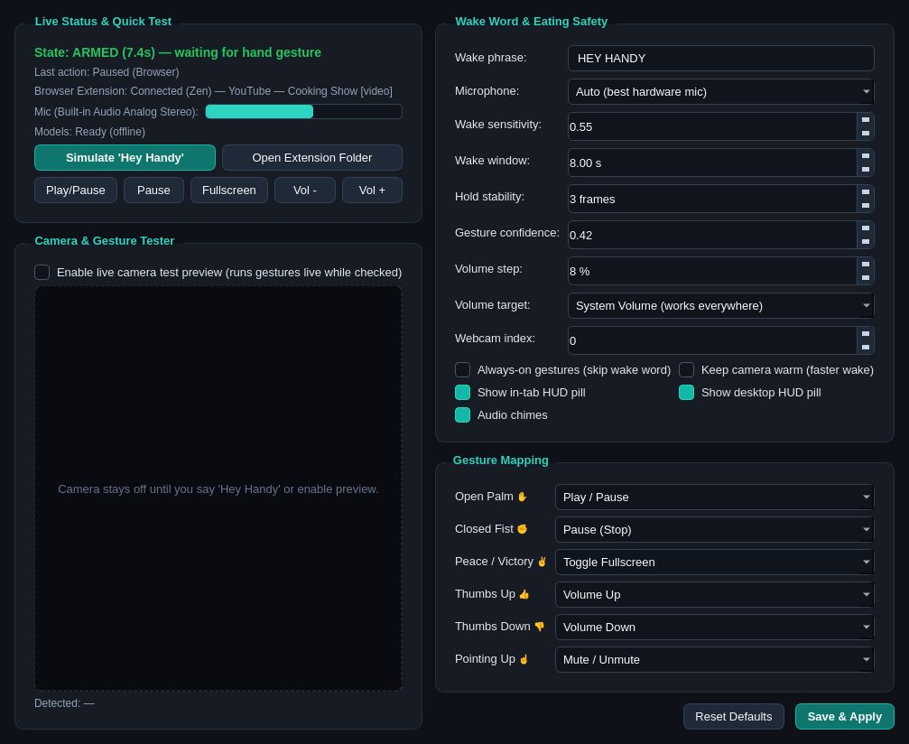

# Hey Handy

**Wake-word gated hand gesture controller for your active browser video or audio tab — built for eating hands-free.**

Most open-source webcam gesture apps trigger constantly while you eat (seeing a fork, sandwich, or cup near your face as a pinch or palm), force an ugly OpenCV preview window onto your screen, burn CPU with the webcam running 24/7, and send brittle keyboard shortcuts (`Space` / `F`) that scroll the page or miss audio tabs.

**Hey Handy** fixes all of that:



- **Offline `"Hey Handy"` Wake Word (`sherpa-onnx`)**: Your webcam stays **off** while you eat (0% webcam CPU, webcam LED off, zero false triggers). Say **"Hey Handy"** and the app wakes for an 8-second window (extending automatically while you adjust volume), then goes back to sleep.
- **Works on Browser Tabs *and* Laptop Video/Audio Players**: A tiny cross-browser MV3 companion extension (Chrome, Chromium, Brave, Edge, Firefox, Zen) targets `<video>` and `<audio>` elements directly inside the active tab (including Shadow DOM and iframes), and Hey Handy also works automatically across browser windows and local desktop players (`VLC`, `mpv`, `Celluloid`, `Spotify`) via MPRIS / OS media & system volume (`wpctl`/`pactl`/Hyprland on Linux, AppleScript on macOS, Win32 media/volume keys on Windows).
- **Pause & Resume Preserves Timestamp**: Pausing stops playback right where you are; resuming picks up from the exact second you stopped.
- **Zero-Clutter Floating HUD**: No OpenCV debug window blocking your show. Only a sleek translucent corner pill (inside fullscreen browser video too) and a quiet system tray icon.
- **Anti-False-Trigger Guards**: Combines MediaPipe `GestureRecognizer`, 21-landmark finger geometry checks, hand bounding-box filtering, multi-frame stability consensus, and action cooldowns.

---

## Default Gestures

Say **"Hey Handy"**, then hold one clean gesture for ~200 ms:

| Gesture | Action | Behavior |
| --- | --- | --- |
| ✋ **Open Palm** | **Play / Pause** | Pauses playback keeping your timestamp; show again to resume |
| ✊ **Closed Fist** | **Pause (Stop)** | Dedicated pause — guarantees playback stops without accidentally resuming |
| ✌️ **Peace / Victory** | **Toggle Fullscreen** | Expands the active video player fullscreen (or browser window on audio tabs) |
| 👍 **Thumbs Up** | **Volume Up** | Smoothly steps volume up while held and keeps the wake window open |
| 👎 **Thumbs Down** | **Volume Down** | Smoothly steps volume down while held and keeps the wake window open |
| ☝️ **Pointing Up** | **Mute / Unmute** | Quickly mutes/unmutes audio (all gestures remappable in Settings) |

---

## Architecture

```text
Microphone ──▶ sherpa-onnx KWS ("Hey Handy")
                      │
                      ▼  wakes for 8s (camera turns on)
Webcam ──────▶ MediaPipe GestureRecognizer + Landmark Geometry Guards
                      │
                      ▼  localhost WebSocket (ws://127.0.0.1:17421)
Browser Extension (Chrome / Firefox / Zen MV3)
   ├── Active Tab <video> / <audio> + Shadow DOM / iframe targeting
   ├── Cinema Fullscreen + window state + In-Tab HUD Pill
   └── Fallback ─▶ OS Volume & Media (wpctl / pactl / MPRIS / macOS / Win32)
```

---

## Quick Start

### 1. Run the Desktop App

Requires [uv](https://docs.astral.sh/uv/) (automatically fetches Python 3.12 + dependencies on Linux, macOS, and Windows):

```bash
git clone https://github.com/ahmedtarek26/hey-handy.git
cd hey-handy
uv sync --python 3.12
uv run hey-handy --settings
```

On first launch, Hey Handy downloads the compact offline models (~23 MB total) into your user data directory (`~/.local/share/hey-handy/models` on Linux, `%LOCALAPPDATA%\hey-handy\models` on Windows, `~/Library/Application Support/hey-handy/models` on macOS). You can also pre-fetch them:

```bash
uv run hey-handy --download-models
```

### 2. Install the Active-Tab Browser Extension

- **Chrome / Chromium / Brave / Edge**:
  1. Open `chrome://extensions` and turn on **Developer mode**.
  2. Click **Load unpacked** and select the [`extension/`](extension) folder.
- **Firefox / Zen Browser / LibreWolf**:
  1. Open `about:debugging#/runtime/this-firefox`.
  2. Click **Load Temporary Add-on...** and select [`extension/manifest.json`](extension/manifest.json).

Once installed, the extension connects automatically to the desktop app on `ws://127.0.0.1:17421`.

---

## CLI Options

```text
hey-handy --settings         Open the Settings & Live Camera Test window
hey-handy --always-on        Keep gesture recognition active without wake word
hey-handy --no-tray          Run with Settings window open and exit on close
hey-handy --download-models  Download offline ML models and exit
hey-handy --port 17421       Use a custom localhost WebSocket port
```

---

## Running Tests

```bash
uv sync --python 3.12 --extra dev
uv run pytest
```

---

## Troubleshooting

- **Linux Wayland / Hyprland / Omarchy**: System volume uses PipeWire `wpctl` (`pactl` fallback), and native desktop media fallback uses `playerctl` / MPRIS D-Bus. Browser tab control works directly via the extension without needing X11 input injection.
- **Slow USB webcam wakeup**: Enable **Keep camera warm** in Settings so the device stays initialized while sleeping (inference still pauses until `"Hey Handy"` is spoken).
- **Custom wake phrase or noisy room**: Adjust **Wake phrase** and **Wake sensitivity** in Settings.

---

## License

MIT — see [LICENSE](LICENSE).
